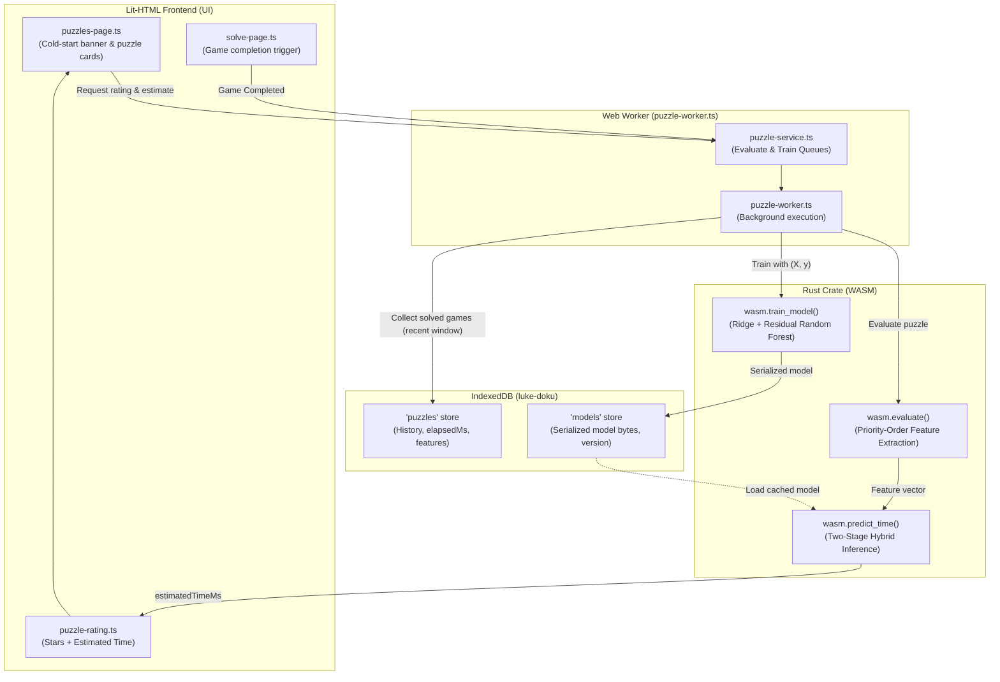

# Machine Learning Solve Time Estimator Design

This document specifies the end-to-end architecture, machine learning specification, data pipeline, and user experience for estimating personalized puzzle solve times in Luke-doku.

---

## 1. Overview & Objectives

Luke-doku generates Sudoku puzzles across five complexity tiers: **Simple**, **Moderate**, **Complex**, **Expert**, and **Lunatic**. While the 5-star complexity rating indicates intrinsic logical difficulty, human solve times vary substantially depending on a player's individual speed, deduction preferences, and experience—as well as structural bottlenecks within a tier (for example, `Simple` puzzles vary by nearly $4\times$ in solve time, and `Expert` puzzles vary by $7\times$ from ~9 minutes to over 60 minutes).

The objective of this feature is to provide a **personalized solve time estimate** for every puzzle (e.g., `★★★☆☆ Moderate • ~5 min`) learned directly from each player's local gameplay history.

### Key Tenets
1. **Purely Personalized:** The model learns the individual player's solve pace and trail habits rather than a generic or global average.
2. **Zero-Backend & Privacy-Preserving:** Training and inference run entirely in the user's browser using WebAssembly (Rust) and Web Workers. No gameplay data or telemetry leaves the device.
3. **Two-Stage Linear-Tree Hybrid (`Ridge + Residual Random Forest`):** A lightweight, dependency-free two-stage regressor implemented in Rust (`crate/`) and compiled to WASM combines an L2-regularized Ridge linear trend with a bagged Random Forest on residuals—delivering strong cold-start accuracy ($N=15$), smooth extrapolation, non-linear regime interaction modeling, and fast (<5 ms) client-side training.
4. **Explicit Cold-Start Lifecycle:** Time estimates remain hidden until the player completes a calibration set of 15 puzzles, after which personalized predictions unlock automatically.
5. **Skill-Adaptive Recency Window:** As players solve hundreds or thousands of puzzles, training operates on a sliding window of recent games to adapt to the player's evolving speed.

---

## 2. System Architecture

The solve time estimation system spans four key layers: the **Rust Core Engine**, **Web Worker Service**, **IndexedDB Storage**, and the **Lit-HTML UI**.



### Flow of Operations

1. **Evaluation & Feature Extraction:** When a puzzle is generated or viewed, `evaluate()` in the Rust crate simulates human-priority logical solving, analyzes stall and trail landscapes, and extracts an immutable structural feature vector $X \in \mathbb{R}^p$.
2. **Game Completion:** When the player solves a puzzle on `solve-page.ts` (`CompletionState.SOLVED`), the solve duration (`elapsedMs`) and command history (`history`) are recorded in IndexedDB.
3. **Background Training:** If $\ge 15$ valid solved games exist, the Web Worker selects an appropriate sample window (up to the most recent 300–500 games with stratified tier minimums), invokes `train_model()` in Rust WASM to fit the Two-Stage `Ridge + Residual Random Forest` model, and persists the serialized model bytes to IndexedDB.
4. **Inference & UI Display:** For unstarted puzzles, the evaluator uses the trained model to predict `estimatedTimeMs`, which `<puzzle-rating>` displays on puzzle cards.

---

## 3. Feature Engineering & Extraction

Features are computed deterministically during the evaluation phase in `crate/src/evaluate/`. Grounded in empirical command-history analysis (where ~38% of total play time is spent on main-grid placements, ~25% on trail placements, ~17% on pre-trail stall search, ~16% on trail comparison/management, and ~3% on manual pencil marks), the purely structural feature vector $X$ captures **four core dimensions**:

```
+---------------------------------------------------------------------------------------+
|                               Puzzle Feature Vector X                                 |
+------------------------------------+--------------------------------------------------+
| Category                           | Features Included                                |
+------------------------------------+--------------------------------------------------+
| 1. Grid, Clue & Multi-Solution     | • Clue count (e.g., 22–38)                       |
|    Topology                        | • Clue variance across rows, cols, blocks        |
|                                    | • Numeral (1–9) clue frequency std-dev & count   |
|                                    |   of high-frequency digits (>= 4 clues)          |
|                                    | • Symmetry conformance ratio                     |
|                                    | • Initial open candidate count                   |
|                                    | • Solutions count (1, 2, or 3)                   |
|                                    | • Ambiguous cell count across solutions (0, 4–7) |
+------------------------------------+--------------------------------------------------+
| 2. Singles, Flow & Cadence         | • Block SingleLoc count                          |
|    (Strict Priority Simulation)    | • Same-numeral SingleLoc transition count &      |
|                                    |   numeral-switch count across greedy chains      |
|                                    | • Line (Row/Col) SingleLoc count & count of      |
|                                    |   Line-SingleLoc-only waves (when BlkSL == 0)    |
|                                    | • SingleNum count & Gating SingleNum-only wave   |
|                                    |   count (waves where all SingleLoc == 0)         |
|                                    | • SingleNum avg peer-density difficulty          |
|                                    | • Choke point count (waves with == 1 single) &   |
|                                    |   low-availability wave count (<= 2 SingleLocs)  |
|                                    | • Avg concurrent Block SingleLoc availability    |
+------------------------------------+--------------------------------------------------+
| 3. Advanced Patterns & Chains      | • Required Overlap count (Pointing/Claiming)     |
|    (No-Auto-Pencil-Mark Weighted)  | • Required Block Hidden Subsets (Pairs/Triples)  |
|                                    | • Required Line Hidden & Naked Subsets (Pairs,   |
|                                    |   Triples, Quads — require manual pencil marks)  |
|                                    | • Required Moderate Wings (Unfinned X-Wing,      |
|                                    |   1-Row 2-String Kite)                           |
|                                    | • Required Complex Patterns (Finned/Sashimi      |
|                                    |   Fish, Swordfish, Jellyfish, Skyscraper,        |
|                                    |   Empty Rectangle, 2-Row Kite)                   |
|                                    | • Max & total Implication nesting depth and      |
|                                    |   multi-antecedent width                         |
+------------------------------------+--------------------------------------------------+
| 4. Trail, Bifurcation & Stall      | • Requires Trails (Boolean flag)                 |
|    Landscape                       | • Evaluated Complexity tier (1 to 5)             |
|                                    | • Unset cell count & visible candidate count at  |
|                                    |   first SingleLoc stall and full-deduction stall |
|                                    | • Premature-trail gap (cells solvable between    |
|                                    |   first SingleLoc stall and full-deduction stall)|
|                                    | • Bivalue cell count & Bilocal unit count at     |
|                                    |   stall (primary human trailhead candidates)     |
|                                    | • Bivalue Crack Ratio at stall (fraction of      |
|                                    |   bivalue cells where pure-single trails either  |
|                                    |   solve the board or hit a contradiction)        |
|                                    | • True-branch full-solve rate & False-branch     |
|                                    |   pure-single contradiction rate at stall        |
|                                    | • Full-solve disproof count (productivity ==     |
|                                    |   remaining non-ambiguous cells), max/mean       |
|                                    |   disproof productivity, sequential disproof     |
|                                    |   series count, and contradiction depth          |
+------------------------------------+--------------------------------------------------+
```

### 3.1 Priority-Order Feature Extraction & Numeral Cadence

In Luke-doku, there are **no automated pencil marks**. Empirical gameplay analysis reveals three major consequences for how humans execute deductions:

1. **Strict Human Priority Hierarchy:**
   In [`evaluate_complexity`](../crate/src/evaluate/internals.rs#L9-L52), once the complexity watermark rises to `Moderate` or `Complex` on an early wave, `find_facts` invokes `deduce_all()` on every subsequent wave and applies all deductions up to the watermark simultaneously—even when simple `Block SingleLoc`s are available. Similarly, applying `SingleNum`s in the same wave as `Block SingleLoc`s can misclassify cells that would have become trivial `Block SingleLoc`s after the current wave's `Block SingleLoc`s were placed.
   To avoid over-counting advanced patterns or naked singles, feature extraction simulates solving in **strict human priority order**:
   $$\text{Block SingleLoc} \;\succ\; \text{Line SingleLoc} \;\succ\; \text{SingleNum} \;\succ\; \text{Overlap} \;\succ\; \text{Block Hidden Subset} \;\succ\; \text{Line/Naked Subset} \;\succ\; \text{Wings/Fish/Chains}$$
   Lower-priority deductions are only applied when all higher-priority deductions are exhausted (`count == 0`).

2. **Same-Numeral Chaining vs. Numeral Switching (`4.5x` Speed Ratio):**
   Gameplay logs show that placing a `Block SingleLoc` on the **same digit** as the immediately preceding move takes a mean of **`2.1s`** (`1.5s` median), whereas switching to a **different digit** takes **`9.4s`** (`5.0s` median)—a **$4.5\times$ difference**. Likewise, initial **numeral clue frequency skew** (how many digits start with $\ge 4$ clues vs. a flat 2–3 clues per digit) determines whether a 23-clue `Simple` puzzle cascades in 4 minutes or grinds through 12 low-availability waves in 8.5 minutes.

3. **Block Hidden Subsets vs. Line/Naked Subsets (`2.1x` Mean / `4.8x` P90 Ratio):**
   Without auto-pencil marks, a **Hidden Pair/Triple in a 3x3 Block** (`~21.2s` mean, `8.1s` median) is spotted visually via block crosshatching. By contrast, **Row/Col Hidden Subsets and Naked Subsets** (`~44.8s` mean, `225.5s` P90) require manually populating `SET_NUMS` pencil marks across a line or block to spot. Separating `(Block Hidden Subsets)` from `(Line Hidden / Naked Subsets)`—and tracking `Implication` nesting depth (`Overlap => Overlap => Subset => Single`)—captures why certain `Complex` puzzles take 30+ minutes.

### 3.2 Detailed Trail, Bifurcation & Stall Landscape Metrics

In `Expert` and `Lunatic` puzzles (as well as `Moderate`/`Complex` puzzles gated by unspotted `Fish` or `Skyscrapers`), trail exploration accounts for **over 57% of total solving time** (`24.8%` trail placements, `16.9%` pre-trail stall search, and `16.1%` trail switching/comparison/copying).

Crucially, players do **not** only use trails for single-candidate disproof elimination; in **two-thirds of trail games**, players branch on a **bivalue cell or bilocal unit** (testing $A$ and/or $B$ in parallel trails) and use **`COPY_FROM_TRAIL`** when a true branch cascades to a solution. Furthermore, raw `Productive Disproof Count` (`calculateErroneousProductivity > 0`) is nearly constant (`26–38`) across both 9-minute and 62-minute `Expert` puzzles. What actually separates a 9-minute `Expert` solve from a 62-minute `Expert` solve are four stall-point metrics:

1. **Stall-Point Board Openness (`Unset Cells` & `Visible Candidates` at Stall):**
   Fast `Expert` solves (`9–12 min`) fill `44–50` cells via pure singles before stalling, leaving only `31–37` unset cells (`85–100` visible candidates). Slow `Expert` solves (`25–62 min`) stall almost immediately at `25–27` filled cells (`54–56` unset cells, `200+` visible candidates).
2. **Bivalue Cell Count & "Bivalue Crack Ratio":**
   At the stall point, we count cells with exactly 2 visible candidates (`BivalueCells`) and compute the **Bivalue Crack Ratio**: the fraction of bivalue cells where propagating **pure singles** on either candidate branch either solves the entire board (`COPY_FROM_TRAIL`) or hits a direct contradiction. In 9-minute `Expert` puzzles, `14/14` (`100%`) of bivalue cells immediately crack the puzzle; in 60-minute `Expert` puzzles, only `1/4` (`25%`) crack, while over `60%` of false branches fizzle out after ~10 steps without reaching a contradiction.
3. **The "Premature Trail Trap" (`SingleLoc`-Stall vs. Full-Stall Gap):**
   When playing a puzzle labeled `★★★★☆ Expert`, players crosshatch `Block` and `Line SingleLoc`s until none remain. If the puzzle is gated by a lone `SingleNum` or `Subset` at `28/81` before the true `Expert` stall at `40/81`, players often mistake the `SingleLoc` exhaustion at `28/81` for the `Expert` stall point and launch trails prematurely on a starved board (as in `2026-10-29 #2`, adding 25+ minutes). Tracking the **cell gap between the first `SingleLoc` stall and the full-deduction stall** (and counting gating `SingleNum` waves on `Expert` puzzles) directly models this trap.
4. **De Facto Trail Bottlenecks on `Moderate`/`Complex` Puzzles:**
   When a `Moderate` or `Complex` puzzle is gated by a `Skyscraper`, `Finned X-Wing`, `Swordfish`, or `Jellyfish`, players rarely spot the pattern directly; instead, because the star rating does not say `Expert`, they spend `4–11 minutes` searching for a simpler deduction before giving up and creating a trail (`2026-11-08 #1`, `2026-11-07 #4`, `2026-10-27 #1`). Counting these high-difficulty wing/fish bottlenecks allows the forest to predict this long pre-trail search delay.

### 3.3 Multi-Solution Endgames (`1`, `2`, or `3` Solutions)

Approximately 10% of generated Luke-doku puzzles have **2 or 3 valid solutions** (capped at at most `7` ambiguous cells across solutions, i.e., `4`, `6`, or `7` ambiguous cells).
* Ambiguous cells **cannot be deduced uniquely by logic**—pure deduction stalls with `4–7` cells remaining, requiring the player either to branch with trails or to resolve the unavoidable rectangle/pattern and determine whether the puzzle has `1`, `2`, or `3` total solutions for the completion dialog.
* Including **`solutions_count`** (`1`, `2`, `3`) and **`ambiguous_cell_count`** (`0`, `4`, `6`, `7`) in $X$ ensures that multi-solution puzzles are properly distinguished from single-solution stalls and that `FullSolve` disproof productivity is measured against the `81 - ambiguous_cell_count` deducible cells.

### 3.4 Linear Additive Trends vs. Non-Linear Regime Interactions

Sudoku solve time combines two structurally distinct mechanisms:
1. **Global Additive Step Costs:** A puzzle requiring more digit switches, `Line SingleLoc`s, `SingleNum`s, subsets, or unset stall cells takes proportionally longer. Axis-aligned decision trees are inefficient at learning linear combinations ($\sum w_j X_j$), especially in the small-sample cold-start regime ($N = 15\text{--}30$) where each bootstrap tree has only 5–10 splits, and standard tree ensembles cannot extrapolate beyond $[\min(y_i), \max(y_i)]$.
2. **Conditional Regime Interactions:** Non-linear thresholds—such as a `Moderate`/`Complex` puzzle gated by a `Complex` fish/wing (`complex_fish > 0`) that forces the player into an unannounced trail search, or `requires_trails == 1` interacting with `bivalue_crack_ratio` and `premature_trail_gap`—cannot be captured by a linear hyperplane.

Rather than relying on a standalone Random Forest or a brittle hand-coded `baseline_time_ms` formula, we use a **Two-Stage Hybrid (`L2 Ridge Regression + Residual Random Forest`)**:
* **Stage 1 (Standardized L2 Ridge Regression)** learns the global linear difficulty slope directly from the player's recent log-solve-times $y_i = \ln(\text{elapsed\_ms}_i)$, handling additive step scaling and smooth upper-tail extrapolation without requiring a separate per-move speed tracker.
* **Stage 2 (Random Forest on Ridge Residuals)** fits bagged decision trees to the residuals $r_i = y_i - \hat{y}_{\text{Ridge}}(X_i)$, dedicating 100% of its tree splits to non-linear regime interactions.

---

## 4. Machine Learning Specification: Two-Stage Ridge + Residual Random Forest

### 4.1 Two-Stage Target & Residual Formulation

Human solve times are strictly positive and follow a right-skewed log-normal distribution, so training operates in log-duration space $y_i = \ln(\text{elapsed\_ms}_i)$:

1. **Stage 1 — Standardized L2 Ridge Regression:**
   For each feature $j \in \{1, \dots, p\}$, we compute the training mean $\mu_j$ and standard deviation $\sigma_j$ (with $\sigma_j = 1$ if constant) to form standardized features $Z_{ij} = (X_{ij} - \mu_j) / \sigma_j$, and solve the $p \times p$ regularized normal equations via Gaussian elimination with partial pivoting:
   $$(Z^\top Z + \lambda I)w = Z^\top (y - \bar{y})$$
   At inference time, standardized inputs are clamped to $[-4, +4]$ to prevent extreme single-feature outliers from exploding extrapolations:
   $$\hat{y}_{\text{Ridge}}(X) = \bar{y} + \sum_{j=1}^{p} w_j \cdot \text{clamp}\!\left(\frac{X_j - \mu_j}{\sigma_j},\; -4.0,\; +4.0\right)$$

2. **Stage 2 — Bagged Random Forest on Residuals:**
   We compute the in-sample non-linear residuals $r_i = y_i - \hat{y}_{\text{Ridge}}(X_i)$ and train an ensemble of $B$ decision trees $\{T_b\}_{b=1}^{B}$ on $(X, r)$.

3. **Combined Prediction:**
   $$\widehat{\text{time}}_{\text{ms}}(X) = \exp\!\left(\hat{y}_{\text{Ridge}}(X) + \frac{1}{B} \sum_{b=1}^{B} T_b(X)\right)$$

### 4.2 Walk-Forward Empirical Benchmark (160 Real Solved Games)

Evaluated via walk-forward out-of-sample testing across the 160 most recent valid solved games in Chrome IndexedDB (`Cold-Start N=15`, `Early N=30`, and `Mature N=80`), the Two-Stage `Ridge + Residual Random Forest` outperforms every standalone alternative across all sample regimes:

| Model Architecture | Cold-Start (`N = 15`)<br/>Log-RMSE / **Log-R²** | Early (`N = 30`)<br/>Log-RMSE / **Log-R²** | Mature (`N = 80`)<br/>Log-RMSE / **Log-R²** | Mature MAE (min) |
| :--- | :---: | :---: | :---: | :---: |
| **1. Tier Mean (Stars only)** | `0.486` / **`0.386`** | `0.479` / **`0.403`** | `0.454` / **`0.466`** | `4.24 min` |
| **2. Pure GBDT** (`d=3, lr=0.08`) | `0.487` / **`0.383`** | `0.428` / **`0.523`** | `0.389` / **`0.607`** | `3.66 min` |
| **3. RF on Hand-Coded Speed Baseline** | `0.494` / **`0.367`** | `0.418` / **`0.546`** | `0.395` / **`0.596`** | `3.71 min` |
| **4. Pure RF** ($m = \lfloor\sqrt{p}\rfloor = 6$) | `0.477` / **`0.409`** | `0.433` / **`0.513`** | `0.378` / **`0.628`** | `3.54 min` |
| **5. Pure RF** ($m = \lceil p/2 \rceil = 15$) | `0.471` / **`0.425`** | `0.418` / **`0.547`** | `0.378` / **`0.628`** | `3.51 min` |
| **6. L2 Ridge Regression Only** | `0.452` / **`0.468`** | `0.428` / **`0.524`** | `0.404` / **`0.577`** | `3.85 min` |
| **7. Two-Stage (`Ridge + GBDT`)** | `0.465` / **`0.439`** | `0.417` / **`0.549`** | `0.368` / **`0.649`** | `3.49 min` |
| **8. Two-Stage (`Ridge + Residual RF`)** | **`0.448` / `0.479`** | **`0.412` / `0.559`** | **`0.364` / `0.656`** | **`3.50 min`** |

### 4.3 Algorithm Parameters

| Parameter | Default Value | Rationale |
| :--- | :--- | :--- |
| **Ridge Penalty ($\lambda$)** | `30.0` | Strong L2 shrinkage stabilizes collinear features at $N = 15$ and yields smooth residual targets. |
| **Standardized Clamp** | `[-4.0, +4.0]` | Bounds linear extrapolation on extreme unseen feature counts. |
| **Number of Trees ($B$)** | `40` | Strong variance reduction on residuals while keeping serialized model size < 40 KB. |
| **Max Depth ($D_{\text{max}}$)** | `4` | Since Stage 1 removes the global linear trend, shallow depth-4 trees capture regime interactions without overfitting. |
| **Min Samples per Leaf ($n_{\text{min}}$)** | `2` | Preserves resolution on rare difficulty bottlenecks (`Complex` fish, `Lunatic` stalls). |
| **Feature Subsampling ($m$)** | $\lceil p / 2 \rceil \approx 15$ | Because $X$ is block-sparse by regime (~10 trail features are `0` on non-trail puzzles), sampling $p/2$ features rather than $\lfloor\sqrt{p}\rfloor$ ensures every split evaluates active features. |
| **Bootstrap Sampling** | $N$ with replacement | Standard bagging keeps residual predictions near $0$ when $N$ is small and noisy. |
| **Split Criterion** | Mean Squared Error (MSE) | Maximizes variance reduction across partitions $S_L$ and $S_R$. |

The variance reduction criterion used during residual tree split selection is:

$$\Delta I = \text{Var}(S) - \frac{N_L}{N}\text{Var}(S_L) - \frac{N_R}{N}\text{Var}(S_R)$$

where $N = |S|$, $N_L = |S_L|$, and $N_R = |S_R|$.

### 4.4 Evaluation of Existing Rust ML Crates vs. In-Tree Implementation

Before writing a bespoke regressor, we evaluated existing Rust ML crates for suitability in a client-side WASM environment:

| Crate | Pros | Cons / Net Assessment |
| :--- | :--- | :--- |
| **`smartcore`** | Feature-rich random forest & linear models. | **Heavy dependencies** (`nalgebra`, BLAS bindings); noticeably balloons the WASM binary (+1–2 MB); can encounter build friction on `wasm32-unknown-unknown`. |
| **`linfa` / `linfa-trees`** | Clean modular architecture ("scikit-learn for Rust"). | Dependent on `ndarray`; brings excess abstraction for a compact two-stage regressor. |
| **Lightweight crates** (e.g. `decision-tree`) | Smaller surface area. | Often unmaintained, lack `serde` compatibility out of the box, or lack regression support (classification only). |
| **Tailored In-Tree Engine** (`crate/src/evaluate/forest.rs`) | **Zero external dependencies**; compiled size < 12 KB; 100% deterministic; native two-stage `Ridge + Residual RF` in ~300 lines of idiomatic Rust. | Maintained directly in-tree. |

**Recommendation:** Implement the two-stage `Ridge + Residual Random Forest` regressor in-tree under `crate/src/evaluate/forest.rs`. Both the $p \times p$ Cholesky/Gaussian solver (~45 lines) and the CART decision tree builder (~200 lines) require zero external dependencies and train in $< 3\text{ ms}$ in WASM.

### 4.5 Rust Data Structures

```rust
// crate/src/evaluate/forest.rs

#[derive(Clone, Debug, Serialize, Deserialize)]
pub struct RidgeModel {
  pub intercept: f32,
  pub means: Vec<f32>,
  pub stds: Vec<f32>,
  pub weights: Vec<f32>,
}

impl RidgeModel {
  pub fn predict(&self, features: &[f32]) -> f32 {
    let mut sum = self.intercept;
    for i in 0..self.weights.len() {
      let z = ((features[i] - self.means[i]) / self.stds[i]).clamp(-4.0, 4.0);
      sum += self.weights[i] * z;
    }
    sum
  }
}

#[derive(Clone, Debug, Serialize, Deserialize)]
pub struct TreeNode {
  pub feature_index: usize,
  pub threshold: f32,
  pub left_child: Option<Box<TreeNode>>,
  pub right_child: Option<Box<TreeNode>>,
  pub leaf_value: Option<f32>, // Residual r = y - y_ridge if leaf
}

#[derive(Clone, Debug, Serialize, Deserialize)]
pub struct DecisionTree {
  pub root: TreeNode,
}

#[derive(Clone, Debug, Serialize, Deserialize)]
pub struct SolveTimeModel {
  pub ridge: RidgeModel,
  pub residual_trees: Vec<DecisionTree>,
  pub training_sample_count: usize,
  pub model_version: u32,
}

impl SolveTimeModel {
  pub fn train(x_flat: &[f32], features_per_sample: usize, y_ms: &[f32], config: &ModelConfig) -> Self { ... }
  pub fn predict(&self, features: &[f32]) -> f64 {
    let linear_log = self.ridge.predict(features);
    let residual_log: f32 = if self.residual_trees.is_empty() {
      0.0
    } else {
      self.residual_trees.iter()
        .map(|t| t.predict(features))
        .sum::<f32>() / (self.residual_trees.len() as f32)
    };
    ((linear_log + residual_log) as f64).exp()
  }
}
```

---

## 5. Lifecycle: Cold-Start, Scaling & Data Management

The application operates in two distinct phases depending on how many valid puzzles the player has solved.

```
       +-----------------------------------------------------------+
       | Player solves games locally (stored in IndexedDB)         |
       +-----------------------------------------------------------+
                                    |
                                    v
                        [ Valid Solved Games Count ]
                                    |
             +----------------------+----------------------+
             |                                             |
             v (< 15 games)                                v (>= 15 games)
  +-------------------------------------+   +-------------------------------------+
  |          COLD-START PHASE           |   |            TRAINED PHASE            |
  | • Puzzle cards: stars only          |   | • Puzzle cards: stars + est. time   |
  | • Cold-start banner: progress shown |   | • Background model retraining       |
  |   (e.g., "Unlocks in 4 games")      |   | • Sliding recency window (300-500)  |
  | • Features cached in IndexedDB      |   | • Dynamic time formatting           |
  +-------------------------------------+   +-------------------------------------+
```

### 5.1 Phase 1: Cold-Start ($N < 15$)

Before 15 valid games are solved:
* **Puzzle Cards:** `<puzzle-rating>` renders complexity stars and category text only (e.g., `★★★☆☆ Moderate`). No time estimate or blank placeholder is shown on individual cards.
* **Progress Banner:** A subtle progress chip or banner appears on the [Puzzles Page](../www/src/app/puzzles-page.ts):
  > *"Personalized solve time estimates unlock in **4** games (11/15 completed)."*
* **Data Ingestion:** As each puzzle is solved, its feature vector $X$ and `elapsedMs` are saved in the `puzzles` IndexedDB object store so they are ready for instant training when the threshold is hit.

### 5.2 Phase 2: Trained State ($N \ge 15$)

Once the player completes their 15th valid puzzle:
1. **Trigger:** The Web Worker automatically launches `train_model()`.
2. **Model Persistence:** The trained forest is saved to the `models` store in IndexedDB.
3. **Banner Dismissal:** The cold-start banner disappears from the Puzzles Page.
4. **Active Predictions:** Unstarted and daily puzzles are evaluated against the model, and estimated solve times appear across all puzzle cards.
5. **Incremental Retraining:** The model retrains in the background on every subsequent puzzle completion.

### 5.3 Large Dataset Scaling & Recency Windows ($N = 500\text{ to }20{,}000+$)

As dedicated players accumulate hundreds or thousands of completed puzzles:

1. **The Skill Evolution Challenge:** A player who has completed 2,500+ puzzles solves significantly faster than when they started. Training on all-time history introduces stale, slower predictions.
2. **Sliding Recency Window:** The training pipeline selects a window of the **most recent 300 to 500 valid solved games** ($K_{\text{max}} = 500$). This ensures the model tracks the user's current solving proficiency.
3. **Stratified Fallback for Rare Tiers:** If a player rarely plays `Lunatic` or `Complex` puzzles, a strict 500-game recency cutoff might starve the training set of rare complexity tiers. The dataset builder enforces a **stratified minimum** (retaining the most recent $\ge 15$ samples of each complexity tier even if they fall outside the 500-game window).
4. **Execution Performance:** With $K \le 500$, training 30 trees in Rust WASM takes $< 3\text{ ms}$, ensuring zero impact on UI responsiveness even after 20,000 games.

### 5.4 Data Quality & Outlier Filtering

To avoid training on skewed or invalid data while preserving legitimate long solves:
* **First-Attempt Only:** Only games solved on their initial attempt (`previousAttempts` is empty or 0) are used. If a player abandons a game, checks the review page, and plays it again via `playAgain()`, that generates a second attempt which is excluded from the training set. However, an in-game `UNDO_TO_START` is part of a single continuous attempt.
* **Solved Games Only (Excluding `QUIT`):** In [`game.ts`](../www/src/game/game.ts#L116-L121), quitting a puzzle invokes `markCompleted(CompletionState.QUIT)`, which still sets `attemptState = AttemptState.COMPLETED` in IndexedDB. The training pipeline must inspect the `MARK_COMPLETED` command in `record.history` (or `game.completionState`) to ensure **`completionState === CompletionState.SOLVED`** and exclude `CompletionState.QUIT` records.
* **Command-Gap Idle Filtering (Preserving Legitimate 60-Minute Solves):** A naive total-time cutoff like `elapsedMs > 3.5 * median(complexity tier)` falsely rejects legitimate 60-minute `Expert` solves (such as `2026-11-02 #2` at `61.6m` with 492 active commands and a maximum inter-command gap of only `2.6m`). Because `record.history` stores delta timestamps on every command, idle detection inspects **inter-command timestamp gaps**:
  * Any single unattended gap $\Delta t > 15\text{ minutes}$ (`900,000 ms`) between consecutive commands without an intervening `PAUSE`/`RESUME` is either trimmed (clamped to the player's P95 thinking gap) or causes the record to be excluded as an unattended session.
  * Legitimate long solves with continuous command activity (e.g. 300–500 trail commands with inter-command gaps $< 15\text{ minutes}$) are **retained** so the model accurately learns to predict `~45 min` to `~1 hr` on brutal `Expert` and `Lunatic` puzzles.

---

## 6. Frontend & UI Integration

### 6.1 Puzzle Card Presentation

On [puzzles-page.ts](../www/src/app/puzzles-page.ts), the `<puzzle-rating>` component displays the stars, difficulty name, and formatted estimate:

```
[ Unstarted Puzzle Card ]
+-----------------------------------------------------------+
|  #1  2026-08-16                                           |
|  ★★★☆☆ Moderate • ~5 min                                  |
+-----------------------------------------------------------+
```

### 6.2 Duration Formatting Rules

Estimated durations are rounded to avoid false precision:

| Predicted Milliseconds | Formatted Output |
| :--- | :--- |
| $< 60{,}000\text{ ms}$ | `< 1 min` |
| $1\text{ to }10\text{ minutes}$ | `~M min` (rounded to nearest minute, e.g. `~4 min`) |
| $10\text{ to }60\text{ minutes}$ | `~M min` (rounded to nearest 5 minutes, e.g. `~25 min`) |
| $> 60\text{ minutes}$ | `~H hr M min` (e.g. `~1 hr 15 min`) |

### 6.3 Lit Component Integration

[puzzle-rating.ts](../www/src/app/puzzle-rating.ts) is updated to read `estimatedTimeMs` from the puzzle rating:

```typescript
// www/src/app/puzzle-rating.ts
override render() {
  if (!this.game?.complexity) return undefined;
  
  const complexity = this.game.complexity;
  
  // Predict time dynamically using the latest model so estimates are never stale
  let estimatedMs = undefined;
  if (this.game.features && modelService.hasTrainedModel()) {
    estimatedMs = wasm.predict_time(modelService.getModelBytes(), this.game.features);
  }
  
  const timeText = estimatedMs ? formatEstimatedTime(estimatedMs) : '';

  return html`
    ${iota(5).map(i => html`
      <mat-icon name=${i < complexity ? 'star' : 'star_border'}></mat-icon>
    `)}
    <span class="complexity-text">
      ${complexityText(complexity)}${timeText ? ` • ${timeText}` : ''}
    </span>
  `;
}
```

---

## 7. Storage & Database Schema

The IndexedDB schema (`luke-doku`) in [database.ts](../www/src/system/database.ts) is extended:

### Database Schema Changes

```typescript
export interface LukeDokuDb extends DBSchema {
  puzzles: {
    key: string;
    value: {
      clues: string;
      solutions: string[];
      symmetryMatches: DbSymMatch[];
      puzzleId?: [string, number, number];
      complexity?: wasm.Complexity;
      featuresVersion?: number;        // <--- NEW: Version of the extracted features
      features?: Float32Array;         // <--- NEW: Cached structural feature vector
      attemptState: AttemptState;
      lastUpdated: Date;
      elapsedMs?: number;
      history?: Int8Array;
      previousAttempts?: Int8Array[];
    };
    indexes: {
      byPuzzleId: [string, number, number];
      byStateAndDate: [AttemptState, Date];
    };
  };

  models: {                           // <--- NEW Object Store
    key: string;                      // e.g., 'solve_time_model'
    value: {
      key: string;
      version: number;
      serializedModel: Uint8Array;    // Compact binary serialized Two-Stage (Ridge + Residual RF) model
      trainingSampleCount: number;
      lastTrained: Date;
    };
  };
}
```

---

## 8. Implementation Roadmap

### Phase A: Rust Core Engine & Two-Stage ML Regressor
1. Create `crate/src/evaluate/forest.rs` implementing Stage 1 standardized L2 Ridge regression (Gaussian elimination with partial pivoting) and Stage 2 residual Random Forest training (MSE variance reduction, $m = \lceil p/2 \rceil$ subsampling, bootstrap sampling, and combined prediction).
2. Implement strict human-priority feature extraction and stall/bivalue landscape analysis in `crate/src/evaluate/internals.rs` returning an immutable fixed-width `Vec<f32>`.
3. Expose `train_model(x, y)` and `predict_time(model_bytes, features)` via `wasm-bindgen` in `crate/src/evaluate.rs`.
4. Add unit tests and cargo benchmarks in `crate/tests/` to guarantee training time $< 5\text{ ms}$ on 500 samples.

### Phase B: Worker Service & Data Pipeline
1. Upgrade IndexedDB schema in `www/src/system/database.ts` to add the `models` store and `features` fields.
2. Implement dataset assembly with sliding recency window ($K \le 500$), stratified tier minimums, `CompletionState.SOLVED` verification, and command-gap idle filtering.
3. Add background training queue and evaluation handling in `www/src/worker/puzzle-worker.ts`.

### Phase C: Frontend & UI
1. Add cold-start progress banner to `www/src/app/puzzles-page.ts`.
2. Update `<puzzle-rating>` in `www/src/app/puzzle-rating.ts` to render formatted `estimatedTimeMs`.
3. Verify that ratings and time predictions update reactively upon background worker completion.

---

## 9. Verification & Testing Strategy

1. **Rust Unit & Regression Tests:**
   * Test L2 Ridge linear fitting, Z-score clamping, and residual decision tree splitting against synthetic datasets with both linear additive trends and non-linear interaction thresholds.
   * Verify that single-numeral `Implication`s with `Complex` antecedents (`Skyscraper`, `Finned Fish`, `Swordfish`, `EmptyRectangle`) evaluate to `Complexity::Complex`.
   * Verify deterministic behavior with fixed PRNG seeds and validate serialization round-trip integrity.
2. **Worker Integration Tests:**
   * Test training triggering at exactly 15 solved games.
   * Verify sliding window and stratified tier selection on synthetic 1,000+ game databases.
   * Verify `CompletionState.QUIT` exclusion and command-gap idle filtering (ensuring active 60-minute `Expert` solves are retained while 30-minute unattended gaps are trimmed/excluded).
3. **UI / Visual Verification:**
   * Inspect clean card layout with and without time estimates.
   * Verify cold-start banner counting down correctly from 15 games.
